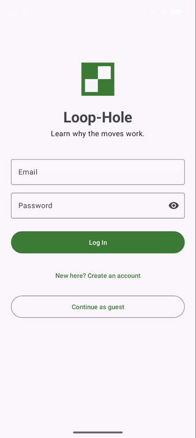
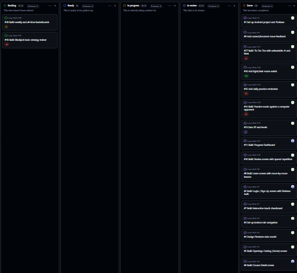
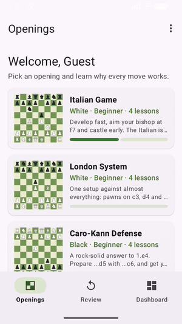

# Milestone 1 - Loop-Hole (Unit 7)

## Table of Contents

1. [Overview](#Overview)
2. [Product Spec](#Product-Spec)
3. [Wireframes](#Wireframes)

## Overview

### Description

Loop-Hole is a free Android chess training app that helps beginner and intermediate players understand chess strategy, improve their decision-making, and play with confidence. Instead of focusing on playing matches, Loop-Hole teaches users why certain moves work. Users pick an opening course, learn each line move by move on an interactive board, and lock it into memory with spaced-repetition reviews. Every feature is free, with no subscriptions, paywalls, or daily limits. Leaderboards, community-created courses, computer opponents, and extra strategy games (Blackjack and Tic-Tac-Toe) are planned for later versions.

### App Evaluation

- **Category:** Games / Education
- **Mobile:** A native Android app (Kotlin) with a touch-friendly chessboard, simple navigation, and short practice sessions users can complete anywhere. It uses **push notifications** when reviews are due or a streak is at risk, **haptic and audio feedback** on correct and incorrect moves, and **real-time** leaderboard updates through Firebase.
- **Story:** A student keeps losing chess games to friends because they don't understand opening strategy. They download Loop-Hole, practice a few openings, review their moves for a week, and walk into their next game already knowing what to play.
- **Market:** Beginner and intermediate chess players, college students, chess clubs, and casual players who want to improve without paying for expensive training tools. Online chess has over 100 million players.
- **Habit:** Spaced repetition creates a review queue every day, so users return daily. Practice streaks, progress tracking, XP, and leaderboards reinforce the habit.
- **Scope:** Version 1 focuses on opening courses, interactive lessons, review sessions, and progress tracking, which is a complete product on its own. Later versions add community courses, computer opponents, engine analysis, and additional strategy games.
- **APIs:** Firebase (Authentication, Firestore, Cloud Messaging), the free Lichess API (opening explorer and real-game move data), and the open-source Stockfish engine.

## Product Spec

### 1. User Features (Required and Optional)

**Required Features**

1. User can create an account and log in using Firebase Authentication
2. User can browse a catalog of available chess opening courses
3. User can select a chess opening and view its details
4. User can learn chess openings through interactive lessons
5. User can move chess pieces on a touch-friendly chessboard
6. User can receive feedback after making correct or incorrect moves
7. User can review previously learned moves without hints
8. User can track completed lessons and overall progress
9. User can access chess training without subscriptions or daily limits

**Optional Features**

1. User can preview the first lesson without creating an account
2. User can maintain a daily practice streak
3. User can earn XP by completing lessons and reviews
4. User can view weekly and all-time leaderboards
5. User can create custom chess opening courses
6. User can publish courses for other users
7. User can practice against computer-generated opponents
8. User can analyze chess positions using Stockfish
9. User can receive daily practice reminders (push notifications)
10. User can switch between light and dark mode
11. Stretch: User can practice Blackjack basic strategy
12. Stretch: User can play Tic-Tac-Toe against an unbeatable AI and get hints on the optimal move
13. Stretch: User can switch between Chess, Blackjack, and Tic-Tac-Toe

### 2. Screen Archetypes

- [x] **Login / Sign Up Screen**
  - User can create an account and log in using Firebase Authentication
  - User can preview the first lesson without creating an account
- [x] **Home / Openings Catalog Screen**
  - User can browse a catalog of available chess opening courses
- [x] **Course Detail Screen**
  - User can select a chess opening and view its details
- [x] **Learn Screen**
  - User can learn chess openings through interactive lessons
  - User can move chess pieces on a touch-friendly chessboard
  - User can receive feedback after making correct or incorrect moves
- [x] **Review Screen**
  - User can review previously learned moves without hints
- [x] **Progress Dashboard Screen**
  - User can track completed lessons and overall progress
  - User can maintain a daily practice streak
- [ ] **Leaderboard Screen** (optional)
  - User can view weekly and all-time leaderboards
- [ ] **Community Screen** (optional)
  - User can browse and publish courses for other users
- [ ] **Course Creator Screen** (optional)
  - User can create custom chess opening courses
- [x] **Practice Opponent Screen** (optional)
  - User can practice against computer-generated opponents
- [ ] **Analysis Board Screen** (optional)
  - User can analyze chess positions using Stockfish
- [ ] **Additional Games Screen** (stretch)
  - User can practice Blackjack basic strategy
  - User can play Tic-Tac-Toe against an unbeatable AI

### 3. Navigation

**Tab Navigation** (Tab to Screen)

- [x] Openings (Home / Openings Catalog)
- [x] Review
- [x] Dashboard
- [ ] Leaderboards (optional)
- [ ] Community (optional)
- [ ] Games (stretch)

**Flow Navigation** (Screen to Screen)

- [x] **Login / Sign Up Screen**
  - => Home (after login or sign up)
  - => Home (continue as guest)
- [x] **Home / Openings Catalog Screen**
  - => Course Detail Screen (select a course)
- [x] **Course Detail Screen**
  - => Learn Screen (start lesson)
  - => Practice Opponent Screen (practice the opening)
  - => Login / Sign Up Screen (guest finishes the preview lesson)
  - => Home Screen (go back)
- [x] **Learn Screen**
  - => Course Detail Screen (complete lesson)
  - => Review Screen (practice learned moves)
  - => Analysis Board Screen (tap "Analyze")
- [x] **Review Screen**
  - => Dashboard Screen (complete review)
  - => Analysis Board Screen (analyze a missed move)
- [x] **Progress Dashboard Screen**
  - => Review Screen (review due moves)
  - => Course Detail Screen (select a course in progress)
- [ ] **Community Screen**
  - => Course Detail Screen (select a community course)
  - => Course Creator Screen (create a course)
- [ ] **Course Creator Screen**
  - => Community Screen (after publishing)
- [ ] **Practice Opponent Screen**
  - => Analysis Board Screen (analyze the game)
  - => Course Detail Screen (go back)
- [ ] **Analysis Board Screen**
  - => Previous screen (go back)
- [ ] **Additional Games Screen**
  - => Blackjack Trainer
  - => Tic-Tac-Toe

## Wireframes

**Hand-Drawn Wireframes**

### [BONUS] Digital Wireframes & Mockups

### [BONUS] Interactive Prototype

 

# Milestone 2 - Build Sprint 1 (Unit 8)

## GitHub Project board

Our board with the three sprint milestones (Sprint 1: Unit 8, Sprint 2: Unit 9, Sprint 3: Demo Day):

## Issue cards

**This sprint (Sprint 1):**

**Next sprint (Sprint 2), with assigned owners:**

## Issues worked on this sprint

- [x] #1 Set up Android project and Firebase (Kotlin, Firebase Auth + Firestore SDKs)
- [x] #2 Build Login / Sign Up screen with Firebase Auth (email/password, input validation, guest mode)
- [x] #3 Set up bottom tab navigation (Openings, Review, Dashboard)

**Completed user stories**

- [x] User can create an account and log in using Firebase Authentication
- [x] User can continue as a guest without creating an account
- [x] User can switch between the Openings, Review, and Dashboard tabs
- [x] User can log out (or sign in from guest mode)

**Build progress (Sprint 1):** login and sign-up validation, guest mode, and tab navigation.

## Firestore data model

Courses ship inside the app (`app/src/main/assets/courses/*.json`) so the catalog works offline and in builds without `google-services.json`. When Firebase is set up, the app reads the catalog from Firestore, and the first signed-in user seeds it from those files. Progress is saved on the device for guests and mirrored to Firestore for signed-in users.

| Collection | Document ID | Fields |
| --- | --- | --- |
| `users` | `{uid}` | `email`, `createdAt` |
| `courses` | `{courseId}` (e.g. `italian-game`) | `name`, `side` (`white`/`black`), `difficulty`, `description`, `order`, `keyMoves` (SAN list), `lessonCount` |
| `lessons` | `{lessonId}` (e.g. `italian-game-1`) | `courseId`, `order`, `title`, `summary`, `moves`: list of `{san, note}`, where `note` explains why the move is played |
| `progress` | `{uid}_{lessonId}` | `uid`, `lessonId`, `courseId`, `completedAt`, `reps`, `intervalDays`, `ease`, `dueAt`, `lastMistakes`, `updatedAt` (SM-2 review schedule) |

Seeded courses: Italian Game, London System (White), Caro-Kann Defense, Sicilian Defense (Black), with 4 lessons each. Lines are based on common Lichess opening data, and every move is checked by a unit test (`CourseContentTest`).

 

# Milestone 3 - Build Sprint 2 (Unit 9)

## GitHub Project board

[Add screenshot of your Project Board with the updated status of issues for Milestone 3. Note that these should include the updated issues you worked on for this sprint and not be a duplicate of Milestone 2 Project board.] 

## Issues worked on this sprint

- [x] #4 Design Firestore data model (users, courses, lessons, progress; 4 seeded courses)
- [x] #5 Build Openings Catalog (Home) screen
- [x] #6 Build Course Detail screen
- [x] #7 Build interactive touch chessboard (legal move validation, board flips for Black)
- [x] #8 Build Learn screen with move-by-move lessons
- [x] #9 Add correct/incorrect move feedback (green/red highlights, sound, haptics, toggles)
- [x] #10 Build Review screen with spaced repetition (SM-2)
- [x] #11 Build Progress Dashboard

## Completed user stories

- [x] User can browse a catalog of available chess opening courses
- [x] User can select a chess opening and view its details
- [x] User can learn chess openings through interactive lessons
- [x] User can move chess pieces on a touch-friendly chessboard
- [x] User can receive feedback after making correct or incorrect moves
- [x] User can review previously learned moves without hints
- [x] User can track completed lessons and overall progress
- [x] User can maintain a daily practice streak

**Pending:** leaderboards, community courses, the course creator, and Stockfish analysis (optional features planned for Sprint 3 or later).

[Add video/gif of your current application that shows build progress]

# Sprint 3 (Unit 10: Demo Day)

## GitHub Project board

Issues #1–#17 are done. Leaderboards (#18) and the Blackjack trainer (#19) are still in the backlog.

## Issues worked on this sprint

- [x] #13 Earn XP and levels (XP for lessons, reviews and practice; level card on the Dashboard)
- [x] #14 Build Practice mode against a computer opponent (it plays random lines from what you've learned)
- [x] #15 Add daily practice reminders (6 pm notification when reviews are due or the streak is at risk)
- [x] #16 Add light/dark mode switch (⋮ menu > Theme)
- [x] #17 Build Tic-Tac-Toe with unbeatable AI and hints (⋮ menu > Tic-Tac-Toe)
- [ ] #18 Build weekly and all-time leaderboards (needs the Firebase project; XP is already saved to `users/{uid}.xp`)
- [ ] #19 Build Blackjack basic strategy trainer (stretch)

## Completed user stories

- [x] User can earn XP by completing lessons and reviews
- [x] User can practice against computer-generated opponents
- [x] User can receive daily practice reminders (push notifications)
- [x] User can switch between light and dark mode
- [x] Stretch: User can play Tic-Tac-Toe against an unbeatable AI and get hints on the optimal move

## App Demo Video

- Embed the YouTube/Vimeo link of your Completed Demo Day prep video

Full walkthrough (3 min, MP4): [docs/loophole-demo.mp4](docs/loophole-demo.mp4)

The GIF below plays at 2.5× speed. It shows a London System lesson (a wrong move, a hint, then the full line), practice against the computer (+14 XP), a perfect spaced-repetition review (+35 XP), the Dashboard at Level 2, turning on the daily reminder, switching to dark mode, and a Tic-Tac-Toe draw using hints.

